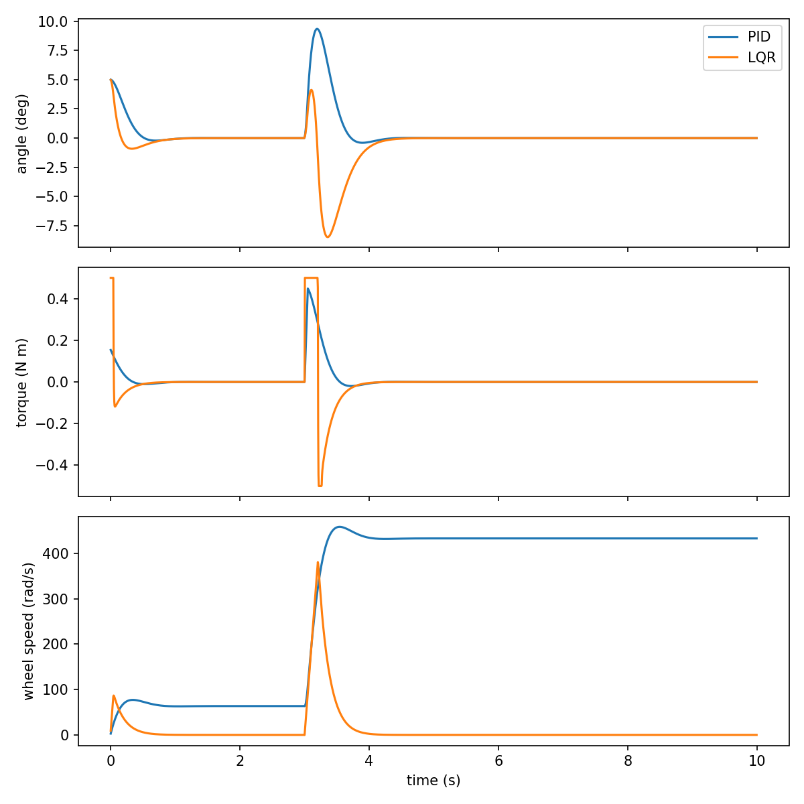

# Reaction Wheel Pendulum: PID vs LQR

Comparison of PID and LQR control for balancing a reaction wheel pendulum, simulated in Python. Parameters come from a CoppeliaSim model.



## Research question
How much sensor noise and actuation delay can PID and LQR controllers tolerate before the pendulum falls, and does a Kalman filter widen that margin?

## Status
- [x] Nonlinear simulation of the pendulum and wheel
- [x] PID controller
- [x] LQR controller
- [x] Comparison after a push disturbance
- [ ] Sensor noise tests
- [ ] Actuation delay tests
- [ ] Kalman filter

## Results so far
Push of 1 N·m for 50 ms at t = 3 s, starting 5° from upright.

| Controller | Settling time (s) | Max angle (deg) | RMS torque (N·m) | Final wheel speed (rad/s) |
|---|---|---|---|---|
| PID | 0.60 | 9.34 | 0.0585 | 432.9 |
| LQR | 0.95 | 8.47 | 0.0970 | 0.0 |

LQR returns the wheel speed to zero, while PID leaves the wheel spinning. PID settles faster in this test.

## Model
State: pendulum angle, angular velocity, wheel speed. Parameters (estimated from the simulation model): pendulum inertia 0.0225 kg·m², wheel inertia 0.00027 kg·m², m·g·l = 0.88 N·m, torque limit 0.5 N·m.

## How to run
```bash
pip install -r requirements.txt
python src/sim_lqr.py
```

## Limitations
- Wheel speed is not limited, so the simulated speeds are unrealistic.
- Parameters are estimates from a simulation model, not a physical robot.
- Noise, delay and the Kalman filter are not tested yet.
