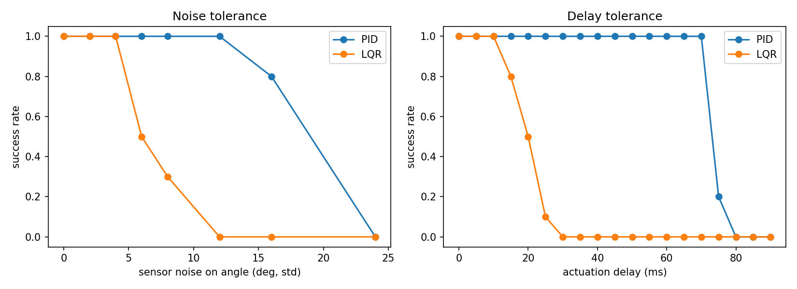

# Reaction Wheel Pendulum: PID vs LQR

Comparison of PID and LQR control for balancing a reaction wheel pendulum, simulated in Python. Parameters come from a CoppeliaSim model.


## Research question
How much sensor noise and actuation delay can PID and LQR controllers tolerate before the pendulum falls, and does a Kalman filter widen that margin?

## Hypotheses and findings
1. **LQR outperforms PID in the nominal case.** Partially supported. LQR returns the wheel speed to zero and has a slightly smaller peak angle, but it settles more slowly and uses more torque.
2. **LQR loses more stability margin to delay than PID.** Supported. Delay margin: 10 ms for LQR, 70 ms for PID.
3. **A Kalman filter restores performance under sensor noise.** Not tested yet.

## Metrics
- **Success rate:** fraction of runs where the pendulum angle never exceeds 30°.
- **Settling time:** time to return within ±1° after a push.
- **Max angle:** peak pendulum angle after a push.
- **RMS torque:** root-mean-square of the wheel torque command.
- **Delay margin:** largest actuation delay with 100% success.

  
## Status
- [x] Nonlinear simulation of the pendulum and wheel
- [x] PID controller
- [x] LQR controller
- [x] Comparison after a push disturbance
- [x] Sensor noise tests
- [x] Actuation delay tests
- [ ] Kalman filter

## Results 

### Nominal case
Push of 1 N·m for 50 ms at t = 3 s, starting 5° from upright.

| Controller | Settling time (s) | Max angle (deg) | RMS torque (N·m) | Final wheel speed (rad/s) |
|---|---|---|---|---|
| PID | 0.60 | 9.34 | 0.0585 | 432.9 |
| LQR | 0.95 | 8.47 | 0.0970 | 0.0 |

LQR returns the wheel speed to zero, while PID leaves the wheel spinning. PID settles faster in this test.

### Noise and delay


| Controller | Max angle noise with 100% success (deg) | Delay margin (ms) |
|---|---|---|
| PID | 12 | 70 |
| LQR | 4 | 10 |

Each condition was run 10 times with different random seeds. Noise is Gaussian on the angle and on the angular velocity. The delay experiments use 0.5° of angle noise.

## Model
State: pendulum angle, angular velocity, wheel speed. Parameters (estimated from the simulation model): pendulum inertia 0.0225 kg·m², wheel inertia 0.00027 kg·m², m·g·l = 0.88 N·m, torque limit 0.5 N·m.

## How to run
```bash
pip install -r requirements.txt
python src/sim_lqr.py
python src/sim_noise_delay.py
```

## Limitations
- Results depend on the controller tuning (LQR weights, PID gains). Other tunings could change the margins.
- Only one push strength was tested.
- Wheel speed is not limited, so simulated speeds are unrealistic.
- Parameters are estimates from a simulation model, not a physical robot.
- The Kalman filter is not implemented yet.

## Next steps
Add a Kalman filter, test other tunings, and compare with a physical or higher-fidelity simulation.

